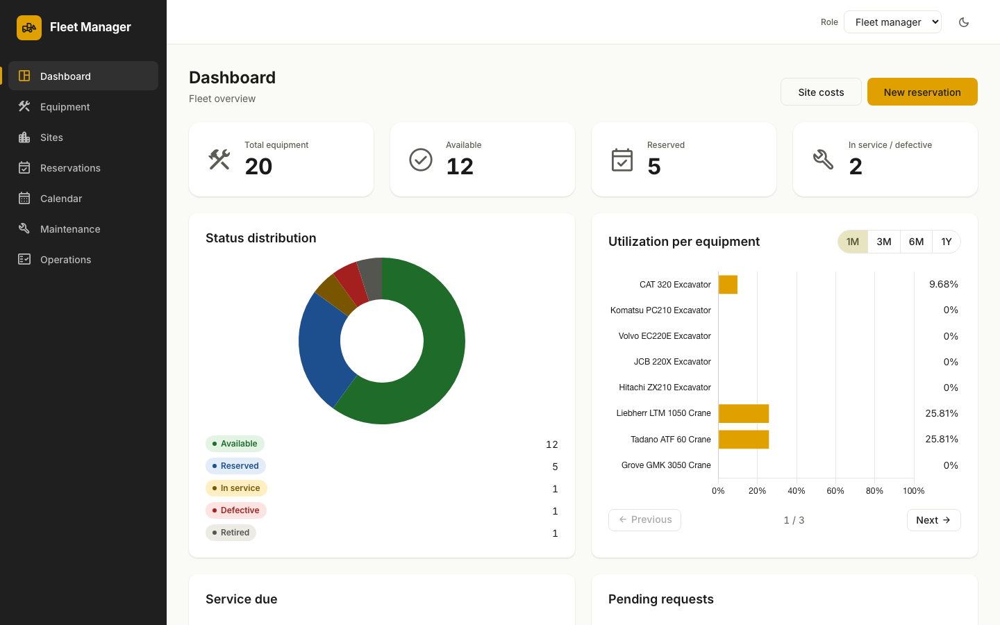
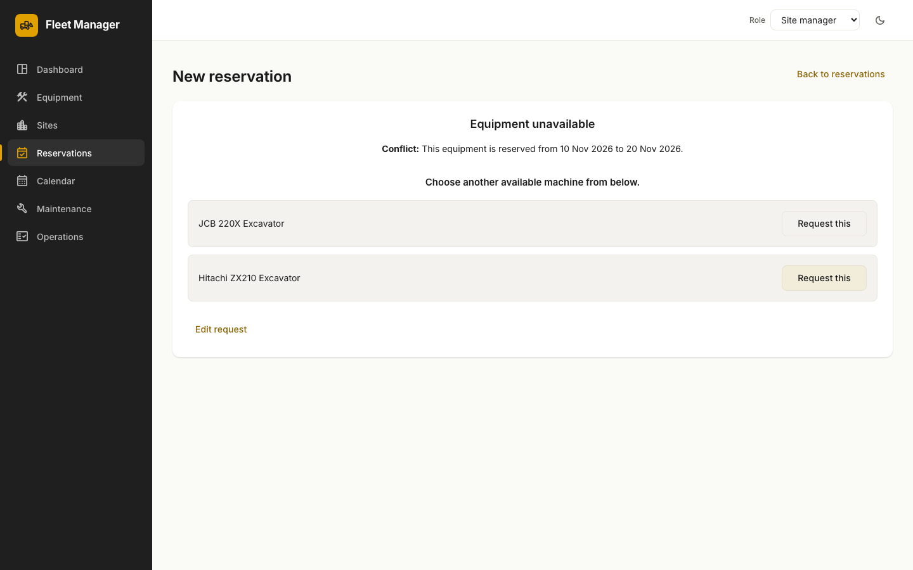
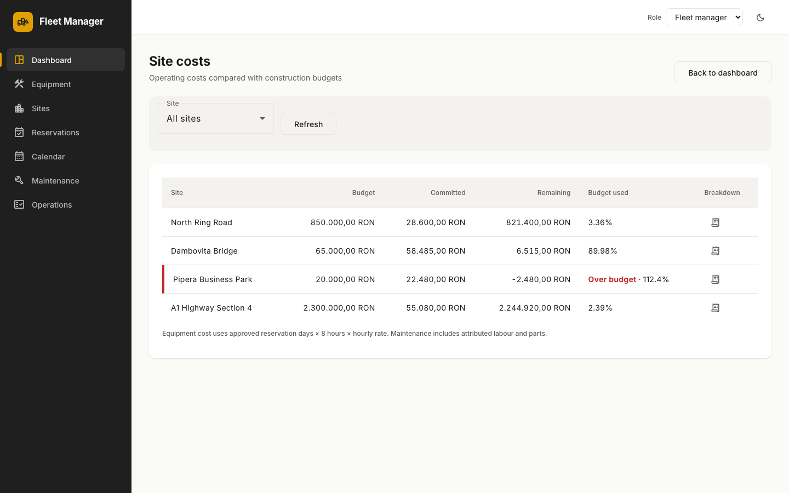
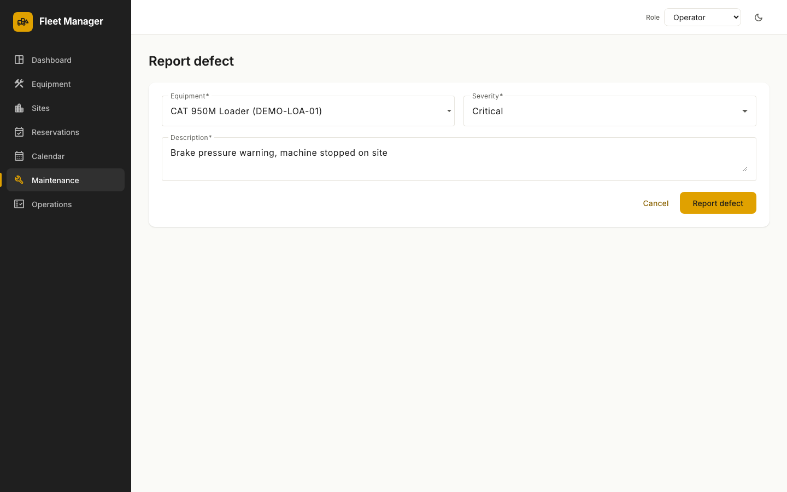
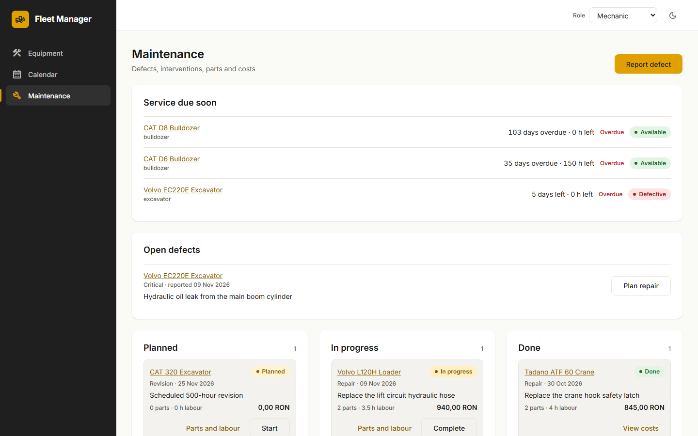

# Fleet Management: Construction Equipment Platform

A web platform for construction companies that centralizes **equipment, site reservations,
maintenance and cost tracking**, so equipment is never double-booked and broken machines
never get sent to a site.

**Stack:** FastAPI · SQLAlchemy 2 · Alembic · PostgreSQL · Angular 20 · Angular Material · Playwright

## Screenshots
| Dashboard | Reservation conflict with alternatives |
|---|---|
|  |  |
| **Site costs vs. budget** | **Reporting a defect** |
|  |  |
| **Maintenance board** | |
|  | |

How to use the app as each role: [docs/USER_GUIDE.md](docs/USER_GUIDE.md).

## Quick start
```bash
docker compose up -d db
cd backend && python -m venv .venv && .venv/Scripts/pip install -r requirements-dev.txt   # Windows
alembic upgrade head && python seed.py && uvicorn app.main:app --reload
cd ../frontend && npm ci && npm start          # http://localhost:4200
```
See the docs below for the full setup.

## Docs
| Doc | What's inside |
|---|---|
| [docs/SCOPE.md](docs/SCOPE.md) | Refined MVP scope for the demo and what is deferred |
| [SETUP.md](SETUP.md) | Installing tools and dependencies |
| [RUNNING.md](RUNNING.md) | Running the app, tests and linters |
| [CONTRIBUTING.md](CONTRIBUTING.md) | Git workflow, PR rules, definition of done |
| [docs/ARCHITECTURE.md](docs/ARCHITECTURE.md) | Repository and module layout |
| [docs/API_CONVENTIONS.md](docs/API_CONVENTIONS.md) | REST conventions shared by BE and FE |
| [docs/USER_GUIDE.md](docs/USER_GUIDE.md) | How to use the app, one section per role |
| [docs/DEMO_SCRIPT.md](docs/DEMO_SCRIPT.md) | Storyline for the 5-minute demo video |
| [docs/STYLE_GUIDE.md](docs/STYLE_GUIDE.md) | UI design system: colours, typography, layout, components |
| [AGENTS.md](AGENTS.md) | Rules for AI coding agents (also read by humans!) |

Original brief (Romanian): [PROJECT_DETAILS.md](PROJECT_DETAILS.md)

## Task tracking
[Sprint board](https://github.com/users/Andrei-Borta/projects/1) · user stories (`story`) with task sub-issues · GitHub Issues + the **"Demo – Nov 12"** milestone. Pick an unassigned issue in your lane
(`backend` / `frontend` / `qa` / `docs`), **assign it to yourself**, and follow [CONTRIBUTING.md](CONTRIBUTING.md).
